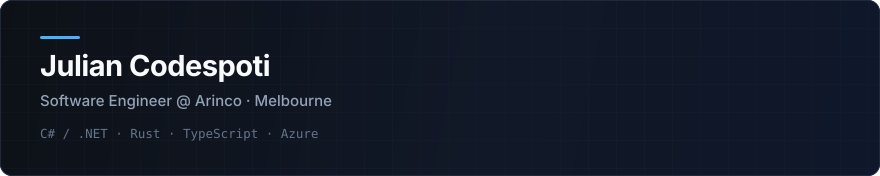

  <picture>
    <source media="(prefers-color-scheme: dark)" srcset="assets/header-dark.svg">
    <source media="(prefers-color-scheme: light)" srcset="assets/header-light.svg">
    
  </picture>

I design and ship production software and AI-assisted systems on Azure, .NET, Rust, and TypeScript. At **[Arinco](https://arinco.com.au)** (previously Senior Full Stack Developer at **MYOB**), I turn complex operational workflows into auditable, low-latency software.

### What I work on

- **Production AI systems:** Agentic pipelines where models handle interpretation and generation while deterministic code owns state transitions, validation predicates, and completion.
- **Evidence & provenance architectures:** Structured document extraction, positional source traceability, and dense review interfaces built for high-throughput human verification.
- **Platform & CI/CD modernisation:** Fleet-scale repository and pipeline migrations (GitLab to GitHub Actions, AWS OIDC, Azure Entra, Terraform/Bicep) driven by automated inventory and verification harnesses.
- **Developer & agent tooling:** Single-binary Rust daemons, local-first mobile companions, and reproducible evaluation harnesses.

### Stack

| Area | Primary tools |
| :--- | :--- |
| **Languages** | C# (.NET 8/10), Rust, TypeScript, Python, SQL |
| **Web & Mobile** | ASP.NET Core, React, Next.js, Tailwind CSS, Progressive Web Apps, Android |
| **Cloud & Infra** | Microsoft Azure, Azure AI Foundry, Docker, GitHub Actions, Azure DevOps, Linux |
| **Engineering** | Event-driven & vertical-slice architecture, OpenTelemetry, replay & latency evals |

### Connect

- **LinkedIn:** [linkedin.com/in/juliancodespoti](https://www.linkedin.com/in/juliancodespoti/)
- **Location:** Melbourne, Australia
